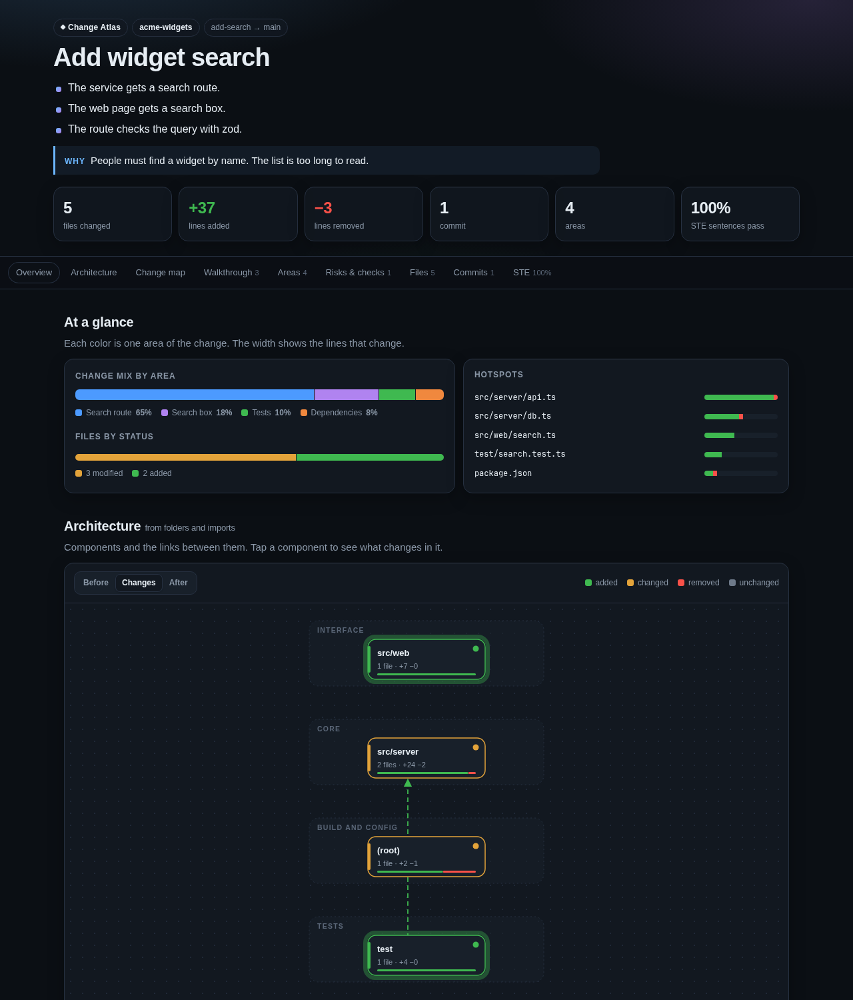

# Change Atlas for Pi Pocket

Pi maps a pull request, a branch, a commit range, or your local changes into an interactive visual
report: an architecture diagram with before and after, a change map, a walkthrough, annotated diffs,
risks, and checks. Pi writes the story of the change in ASD-STE100 (Simplified Technical English), and
the report checks it.



(The picture is a report of a small made-up repository.)

Version **1.0.0** needs **Pi Pocket 0.19.0** or later (extension API **2**).

## Install

**From the gallery:** Menu → Extensions → **Discover**, select **Change Atlas**, read its files, and
install it. It installs off: turn it on in Menu → **Extensions**.

**By hand:** copy these into the `extensions/` folder of Pi Pocket's data folder (by default
`~/.pi-pocket/extensions/`), then turn it on in Menu → Extensions:

```text
extensions/
  change-atlas.ts
  change-atlas/
    index.js
    report.css
    report.js
```

It needs `git` on the server. For a pull request it also needs the GitHub CLI, `gh`, signed in.

## Use

Ask Pi: "Make a Change Atlas of local changes", or "of PR #12", "of `feature`", or "of
`main...feature`". The launcher action **Change Atlas: map a PR or branch** puts that sentence in the
message box. Pi then does two steps:

1. `change_atlas_scan` reads the repository and gives Pi the file list, the commits, the import links,
   and short diff excerpts.
2. `change_atlas_publish` takes Pi's story, builds the report page, and gives back its path. Pi then
   publishes the page with the `artifact` tool, so it opens in Pi Pocket's viewer.

A target is one of these:

| Target               | What Pi maps                                                           |
| -------------------- | ---------------------------------------------------------------------- |
| empty, `local`       | The uncommitted changes, new files too (not the ones that Git ignores) |
| `#12`, `12`, a URL   | A pull request: `https://github.com/<owner>/<repo>/pull/12`            |
| `a..b`               | The difference between two refs                                        |
| `a...b`              | The changes of `b` since it left `a` (from the merge base)             |
| a branch or a commit | The branch against the default branch, or one commit                   |

## What it reads, writes, and sends

**Reads**

- The git repository that holds the session's folder, or one inside the session's folder, with `git`
  (`diff`, `log`, `show`, `rev-parse`, `ls-files`, `remote get-url`). The tools refuse any other
  repository, also through a link. Anyone who can steer a session can make Pi call the tools, and
  Lancet Guard does not see them, so they stay in the session's folder.
- Working tree files that Git does not know yet, when the target is the local changes (up to 200 KB
  each, regular files only: a symbolic link is never followed). Files that `.gitignore` names are not
  read.
- Its own files, `change-atlas/report.js` and `change-atlas/report.css`, to build the page.

**Runs** (always with argument lists, never through a shell)

- `git`, in the repository. A ref that starts with `-` is refused.
- For a pull request: `gh pr view <number>` (with `--repo <owner>/<repo>` for a URL), and `git fetch`
  of `pull/<number>/head` and of the base branch from `origin` (or from the URL's repository). This
  adds the PR's commits to the repository's git objects, and writes `FETCH_HEAD`. It changes no branch and no file of the work
  tree.

**Writes**

- One HTML report for each call of `change_atlas_publish`, in `change-atlas/` in Pi Pocket's data
  folder. The file name has only `a-z`, `0-9`, and `-`. The file and the folder are readable by the
  owner's user only. Nothing deletes old reports.

**Sends**

- To GitHub: only the `gh` and `git fetch` calls above, for a pull request. They use your own `gh` and
  Git sign-in. The tools pass the server's environment to these two programs, as any program that you
  start does.
- To the model provider: every tool result, as for every tool. That is the file list, the commit
  subjects, the PR title and the start of its body, the names of packages that changed, and about 14,000
  characters of changed lines. Text from the repository is quoted and fenced as data.
- To everyone who sees the session: the report, when Pi publishes it with the `artifact` tool. It has
  the diffs of up to 800 files (up to 1,500 lines for each file).
- Nowhere else. The code has no other network call. The report page has none either: its content
  security policy allows only its own script, and no request to any address.

## Secrets

**A diff can hold a secret.** A key in a changed line, or in a new file that is not in `.gitignore`,
goes into the scan that the model provider reads, and into the report file. Change Atlas does not look
for secrets. Do not map changes that hold a secret, and delete the report from `change-atlas/` in the
data folder when you no longer need it. Lock files, minified files, and `dist/`, `build/`, and `vendor/`
folders are listed but their lines are left out.

## What it installs

| Part                        | What                                                                                  |
| --------------------------- | ------------------------------------------------------------------------------------- |
| Extension `change-atlas`    | Two tools: `change_atlas_scan` (read-only) and `change_atlas_publish` (writes a file) |
| Browser module (owner only) | Names the two tools' calls in the session, and adds the launcher action               |
| Routes, hooks, commands     | None                                                                                  |

`change_atlas_scan` has `readOnlyHint: true`: it changes no file and no branch. For a pull request it
adds objects to the repository's `.git` (see "Runs"). `change_atlas_publish` writes a file, so plan
mode does not run it.

## Limits

- 800 files in a report (more are counted), 1,500 diff lines for each file, 1,300,000 characters of
  diff in all, and 600 characters for each line. A bigger diff is cut, and the report says so.
- A scan stops after 120 seconds for each Git or `gh` call.
- The architecture diagram comes from folders and `import` lines (JavaScript, TypeScript, Python, C,
  Go, Rust, Java, and CSS). Other languages show folders only.
- The ASD-STE100 check is a small set of rules (sentence length, passive voice, contractions, and a
  list of words). It is not a full STE checker.

## Develop

```sh
npm install        # or: ln -s <Pi Pocket>/node_modules node_modules
npm run check      # types and syntax
npm test           # tests, with real Git repositories and a fake gh
npm run format:check
```

The tests need `git` and `mkfifo`. They set up their own repositories and a data folder in the system's
temp folder, and a fake `gh` that only prints a fixed answer.

## License

MIT. See [LICENSE](LICENSE).
